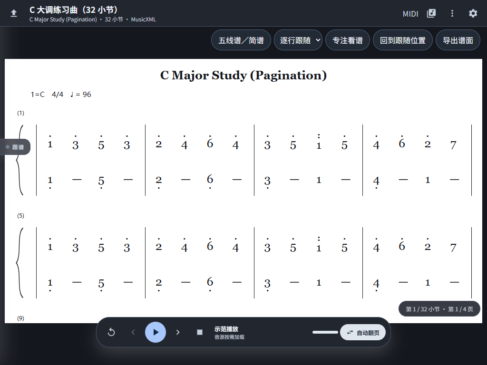
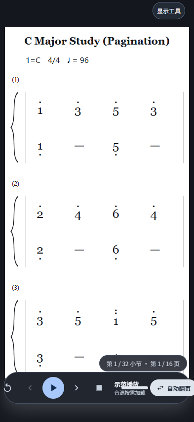

# Web 1.0 测试报告

日期：2026-11-02。参照 Android 1.0 提交 4653d0375abad993de80d49b6184f137fe1af168。

## 算法一致性

- 相同的未修改 TFLite 权重；SHA256 272ebead546bcf342e56aaf3624ec5310c55de86d46aec48868720fad39d01ac。
- 浏览器对用户真实录音前 35 秒实际推理：177 个起音时刻与音高逐项一致。
- 推理平均 112.06 ms、最大 120.6 ms / 128 ms 步长，结束后残留张量为 0。仅代表本机 Chrome，不能推广到手机。
- 1631 个真实钢琴起音的 JS 动态规划路径与 Android / 上游 float32 参考逐项一致。
- 用户 MIDI 转换结果：916 个起音事件的 tick 与完整 MIDI 音高一致。

## 固定数据回归

以下把相同的因果模型输出缓存送入网页实际对齐核心，不重新解码全部音频；
评价标注只在回放结束后读取，不参与定位。全部组已用于开发诊断，不是新盲测。
半拍定义为四分音符的 0.5 倍；总体按有效演奏时间加权。

| 固定组 | 演奏数 | 半拍内定位 |
| --- | ---: | ---: |
| 开发 | 9 | 97.04% |
| 原保留组 | 9 | 97.64% |
| 复核 | 5 | 97.72% |

逐段结果（包括未达到 95% 的段落）：

| 组 | 演奏 | 半拍内 | 误差 P95 / 拍 |
| --- | --- | ---: | ---: |
| 开发 | Bach_Fugue_bwv_858_VuV01M | 98.20% | 0.225 |
| 开发 | Bach_Fugue_bwv_858_Zhang01M | 98.37% | 0.213 |
| 开发 | Bach_Fugue_bwv_862_Song04M | 99.41% | 0.170 |
| 开发 | k279_1 | 98.22% | 0.353 |
| 开发 | k279_2 | 96.68% | 0.318 |
| 开发 | Chopin_op10_no3_p01 | 98.49% | 0.355 |
| 开发 | Chopin_op10_no3_p02 | 98.20% | 0.344 |
| 开发 | Chopin_op38_p01 | 93.39% | 0.618 |
| 开发 | Chopin_op38_p02 | 92.17% | 0.757 |
| 原保留组 | Bach_Fugue_bwv_863_LeeN01M | 99.47% | 0.112 |
| 原保留组 | Bach_Fugue_bwv_863_Shychko01M | 99.47% | 0.125 |
| 原保留组 | Bach_Fugue_bwv_873_Lisiecki13M | 99.80% | 0.157 |
| 原保留组 | k279_3 | 96.91% | 0.337 |
| 原保留组 | k280_1 | 96.20% | 0.410 |
| 原保留组 | Mozart_K331_1st-mov_p01 | 99.56% | 0.259 |
| 原保留组 | Mozart_K331_1st-mov_p02 | 97.94% | 0.270 |
| 原保留组 | Schubert_D783_no15_p01 | 92.88% | 0.611 |
| 原保留组 | Schubert_D783_no15_p02 | 89.20% | 0.682 |
| 复核 | Bach_Fugue_bwv_891_Duepree06M | 96.94% | 0.275 |
| 复核 | Bach_Prelude_bwv_891_BLINOV04M | 99.80% | 0.142 |
| 复核 | Bach_Prelude_bwv_891_Duepree06M | 99.49% | 0.187 |
| 复核 | k281_1 | 97.81% | 0.267 |
| 复核 | k281_2 | 96.48% | 0.405 |

重弹 / 跳转恢复：20 个构造场景，16/20（80%）在三秒内恢复，P95 为 3.674 秒；
**未达到原定 95% 恢复门槛**。重复乐句需要更多后续上下文，不能以猜测强制跳谱。
完整机器结果见 [evidence](evidence/)。

## 功能与浏览器检查

| 检查 | 结果与范围 |
| --- | --- |
| Node 核心 / 图谱 / 简谱 / 导航 | 20 通过，0 失败；静音、错音、停顿、重复歧义、预测不计分、双手节拍、反复路径、跳转防抖 |
| 实际 AudioWorklet → Worker → 模型 | Chrome 虚拟麦克风顺序播放真实录音前缀，635 帧、推进到 tick 17280，无页面 / Worker 错误 |
| Web MIDI 虚拟端口 | 8 个谱面事件，219–220 帧，确认到事件 7；12 个正确音，结算后剩余 180 个音计漏弹；录制保存原始 SMF Blob 150 字节；停止保存练习位置、从曲库导出原始 MIDI 均通过 |
| 手机 / 平板 / 桌面 | 393×852、1024×768、1440×900，五线谱 / 双行简谱、专注模式与关于，无横向溢出、无左右手文字、工具栏不覆盖谱面 |
| 文件 | MXL 打开、双页 PDF 定时滚动、损坏 MusicXML 明确退出加载 |
| 模型资源 | 本地 vendor + 模型，同源加载无外部 CDN、无 404；四个 [1,32,88] 输出 |
| MIDI 互操作 | mido 检查音高、力度、通道、踏板、时间及速度元事件 |

测试命令与外部夹具要求见 [TESTING](TESTING.md)。GitHub Actions 会重复 Node、格式和三个尺寸的 UI 检查。

## 验证边界

- 没有验证实体手机 / 平板麦克风的声学表现、实体 USB MIDI 连接或低性能设备的实时能力。
- 虚拟麦克风端到端检查只覆盖录音前缀；完整固定数据结果来自模型输出缓存回放。
- 评分是基础网页实现，尚未证明与 Android 逐笔评分完全相同。
- 普通跟随总体回归达到 95%，恢复指标仍未达到；不能把上线或界面可用作为所有算法目标已经完成。

## 界面截图

